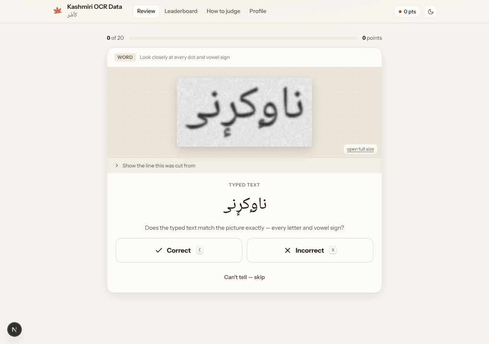

# Kashmiri OCR Data — crowd review app

People look at one picture of printed Kashmiri at a time — a word (or line) cut out of a page by the
segmenter — with the typed text proposed for it, and answer **Correct** or **Incorrect**. If incorrect,
they can type the right text or just submit. Every picture is seen by several people; their answers are
combined into a clean dataset for training Kashmiri OCR.



| | |
|---|---|
| **Review** | the guided page review (below). |
| **Quick check** (`/words`) | one word picture, typed text, two buttons. Keys: `C` correct, `X` incorrect, `S` skip. If incorrect: the text box starts with the typed text so you fix one letter; a complete on-screen Kashmiri keyboard; a tick box for "the box itself is wrong". |
| **Leaderboard** | points, reviews, this week / all time, and the progress of the whole dataset. |
| **Add photos** | photograph Kashmiri pages; they are checked for blur and later cut into words. |
| **Profile** | your stats; sign out on this device. |
| **Admin** (🔒 button, `/admin`) | one admin, signed in with username + password (stays signed in 30 days). Tabs: **People** (name, code, joined, last seen, reviews, points, check items, agreement, speed, photos, devices, flags; block, **reset PIN**), **Answers** (every picture with every person's answer, or one person's), **Photos** (keep / reject uploads), **Data & export** (CSV / JSONL, data per font). PINs are stored one-way and cannot be shown, only reset. |

Reviewers are never told the font, the dataset or which pictures are check items: none of it is sent
to the browser, and picture file names are hashes.

## Three tasks on the Review screen

### Label chunks (main task)

Every chunk (PAW: one connected piece of a word with its own dots and vowel signs) from every page is
put into one pool, and chunks that look the same are grouped (`segmentation/group_chunks.py`). The
same printed piece repeats a lot, so one decision labels many chunks:

1. A grid of look-alike chunks (cleaned crops: only each chunk's own ink). *Are these all the same?*
   **Yes** → step 2. **Some are different** → tap every one that is not the same, then step 2.
2. One chunk large with the proposed text (the word model's most common reading in the group).
   *Is this what they say?* **Correct** → next group. **Incorrect** → type the right text: it labels
   every chunk of the group not marked different. Can't tell → skip.

‹ Back / Next › go through earlier groups to change an answer. Grouping first requires the same **mark
signature** (number and place of dots and signs, so ا آ أ, و ز ژ never mix), then a close match of the
whole piece **and** of its marks (each mark also compared enlarged, so a madd and a hamza differ).
On the 30 starter pages: 4,514 chunks → 3,226 groups (338 of 2–30 look-alikes covering 1,626 chunks;
the rest are single chunks for now and find partners as more pages come in).

Admin → **Chunk labels**; export **Chunk labels (CSV)**: one row per chunk per person, with the text,
`agree` (how many people gave that chunk the same text), the group and the page.

### Match (the popping game)

A board of 6–16 chunks, mixed from different fonts, whose letters share a skeleton (ر ز ڑ ژ, or
مو موٗ مۄ): the same base shapes, different dots and signs, each font drawing them its own way
(`segmentation/make_boards.py`; 157 boards from the starter pages). Tap one chunk, tap every chunk that
is the **same letters** even if drawn differently, press **Pop**: they burst away. Repeat until the
board is clear, or press "The rest are all different". Undo takes back the last set.

Each popped set says "these are one and the same" across fonts: the data for mapping every font onto
one unified form. 1 point per set. Admin → **Match sets**; export **Match sets (CSV)**: one row per
chunk with its `set_id`, font, the model's reading and who made the set.

### Check segmentation

A page goes through two levels, always with the context on top:

1. **Lines** — the page with the lines found as numbered bands. *Are the lines correct?* If not: tap
   inside a band to split it, tap between two bands to join them (Zoom for precision).
2. **Chunks of each line** — the page with that line in blue, and the line with its chunks (same word,
   same colour). *Nothing missing, every dot inside its box?* If not: ✂ split, ⊕ join, ✕ remove.

**Heat map** shows the cleaned ink the segmenter works on. Admin → **Segmentation** shows each page's
decisions per person and how many decided alike.

Every decision in both tasks is saved with who made it, counts 1 point and earns badges (🌱 10, 🍂 100,
🍁 500, 🏔️ 1,000 answers, 📄 first page, 📚 10 pages, ✍️ 10 corrections, 🖋️ 100, 📅 3 days, 📷 5 photos).

Pages to review come from `segmentation/make_pages.py` (segmenter + word model + heat map):

```bash
python3 segmentation/make_pages.py PAGES_DIR out/pages --dataset book1 --font "Gulmarg Nastaleeq"
```
```bash
npm run import:pages -- out/pages --starter
```
```bash
python3 segmentation/group_chunks.py data/groups/manifest.jsonl data/pages/manifest.jsonl --singletons
```
```bash
python3 segmentation/make_boards.py data/match/manifest.jsonl data/pages/manifest.jsonl
```

`--starter` adds them to `data/pages/manifest.jsonl`; the deployed app loads them on its next start.
30 starter pages (5 in each of six fonts, 442 lines, 4,514 chunks) are included, with their groups.

## Run it on your computer

```bash
npm install
```
```bash
npm run import -- data/demo --gold-fraction 0.15
```
```bash
npm run dev
```

Open http://localhost:3000. Without `DATABASE_URL` the app uses a built-in local Postgres (PGlite, in
`.data/`), so nothing else is needed (the import step is optional: an empty database loads `data/demo` by itself).

### Starter data (`data/demo`, 4,103 pictures)

| Font | Pictures |
|---|---|
| Afan Koshur Naksh | 703 |
| Narqalam | 622 |
| Noto Naskh Arabic | 518 |
| Noto Nastaliq Urdu | 408 |
| Gulzar | 328 |
| Gulmarg Nastaleeq | 314 |
| Kaggle word images (font not labelled) | 1,500 |

Pages are rendered from real words of Kaggle `faizaniqbal52/koshur-master-50k-manifest` (half of them
rich in vowel signs) in the fonts of `faizaniqbal52/kashmiri-fonts` plus Noto Naskh and Gulzar, then
segmented by `segmentation/`. Each font only gets words it can draw (Gulzar lacks some Kashmiri letters,
so it skips about 30% of words). The typed text is the Kashmiri word model's reading, so wrong pairs are
real model mistakes: 37% in Gulmarg Nastaleeq, 22% Afan Koshur Naksh, 7–16% in the others. About 15%
of rendered words (known answers) are check items. When `data/demo/manifest.jsonl` grows, a deployed
app adds the new pictures by itself on its next start; existing pictures and answers are untouched.

### Letters and signs a font cannot show

Fonts differ a lot in Kashmiri support. `segmentation/mark_check.py` checks every word before it goes on
a rendered page, at the real print size: each Kashmiri letter must look different from its look-alikes
(ٲ vs أ/ا, ۄ vs و, ؠ vs ی ...), and each vowel sign must add ink that stands clear of the letters.
Found in the six fonts:

| Font | Cannot show |
|---|---|
| Gulmarg Nastaleeq | ۄ ؠ ٳ (missing); ٟ breaks the word; ٕ under some letters |
| Afan Koshur Naksh | ؠ ٟ (missing); ٲ looks like أ, آ like ا, ۅ like و |
| Narqalam | ٳ ٟ (missing); ۄ looks like و |
| Noto Nastaliq Urdu | (nothing found) |
| Noto Naskh Arabic | ٲ looks like أ; ٕ under ھ hidden in the stroke; ٟ invisible |
| Gulzar | ٲ ٳ ۄ ۆ ۅ ؠ ۍ ێ ۓ (missing); ٚ not drawn; ٗ ُ ٕ drawn over letters |

284 starter pictures failed and were removed. Because pixels cannot judge everything a reader sees, a
check item that most reviewers "fail" (3+ answers, under half passing) also stops being a check item and
their penalties are cleared, and the guide tells reviewers to judge only what is visible.

### Keyboard

`lib/ks-keyboard.json` lists every Arabic-script character found in all the data (69,434 Kaggle labels,
the 50k word list, the dictionary, the starter set) plus the standard Kashmiri set: 26 vowel signs and
marks, 62 letters, 21 numbers and punctuation. Rebuild it after adding data:

```bash
python3 scripts/build_keyboard.py lib/ks-keyboard.json kashmiri-ocr.zip master_50k_words_manifest.json data/demo/manifest.jsonl
```

**Not used yet:** `jazz786/handwritten-kashmiri-text-dataset` (51 handwritten pages) has no typed text,
so there is nothing to compare against until the pages are transcribed.

## Put it online (Vercel + Supabase)

**Step 0 — it launches with no setup.** Import the GitHub repo in Vercel (framework: Next.js, all
defaults) and deploy. With no database connected it runs in *preview mode*: a temporary built-in
database with the demo pictures and a banner saying answers are not kept. Everything works, so you
can try it and share the link — then connect Supabase to keep the answers.

**About "Supabase only has one user":** that one user is *you*, the owner of the Supabase project.
This app does not use Supabase logins at all. Supabase is only the database; every reviewer gets their
own row in the `contributors` table, created by the app, so there is no limit on the number of reviewers.

**Easiest: a database made by Vercel.** Vercel → your project → **Storage** → **Create Database** →
**Neon** (Postgres, free plan) → connect it to this project (all environments) → **Redeploy**. Vercel
adds the connection variable itself; the app creates its tables and loads the starter pictures on its
first start. Then add `ADMIN_KEY` under Settings → Environment Variables and redeploy once more.

**Or Supabase**, as below. You need two values from Supabase, not the `sb_publishable_…` key (that key is meant for browsers and
this app does not use it — the server talks to Postgres directly):

1. **Database connection string** — Supabase → your project → **Connect** → *Transaction pooler*
   (port 6543). It looks like `postgresql://postgres.<ref>:<password>@aws-0-<region>.pooler.supabase.com:6543/postgres`.
2. That's all: on its first start the app creates its tables in Supabase and, if there are no
   pictures yet, loads the demo set. (To do it by hand instead: paste `db/schema.sql` into Supabase →
   SQL Editor → Run, or `DATABASE_URL=... npm run db:setup`. `SEED_DEMO=0` skips the demo set.)

There is one admin, username `Admin@890`. The code holds only a slow one-way hash (scrypt) of the
admin password, never the password. Because this repository is public, set your own `ADMIN_USER` and
`ADMIN_PASSWORD` in Vercel when you can; they take priority over the built-in ones.

Then in Vercel → Project → Settings → Environment Variables add:

| Variable | Value |
|---|---|
| `DATABASE_URL` | the connection string from step 1 |
| `ADMIN_USER`, `ADMIN_PASSWORD` | optional: replace the built-in admin username and password (recommended, the repository is public) |

Then **Redeploy** (Vercel → Deployments → ⋯ → Redeploy) so the new variables are used. Never paste
these into the code or a chat; keep them only in Vercel (and in a local `.env` that git ignores).

Load the pictures into the online database from your computer:

```bash
DATABASE_URL='postgresql://...' npm run import -- data/demo --gold-fraction 0.15
```

Images under `public/samples/` are deployed with the site. For large datasets (tens of thousands of
images) upload them to Supabase Storage instead: also set `SUPABASE_URL` and `SUPABASE_SECRET_KEY`
(Supabase → Project Settings → API keys → *secret* key, `sb_secret_…`) and add `--storage supabase`.

## Who is who: username + PIN

- The app opens on the sign-in screen; everything else appears after signing in. A small **Admin**
  link under the form leads to the admin sign-in.
- **Create a profile**: a username (checked live: names that differ only in capitals, spaces, dots,
  dashes or underscores count as the same, so "Zoon Dar" blocks "zoondar"), a 4–6 digit PIN typed twice,
  and consent. **Sign in**: username + PIN, on any device.
- **Remembered browsers**: signing in keeps the browser signed in for 400 days, and also gives it a
  device pass. After signing out, the screen offers **Continue as <name>** with one tap, no PIN.
  "Not <name>?" removes the pass (for shared phones). A PIN reset by the admin removes all passes.
- PINs are stored only as salted scrypt hashes. Five wrong PINs lock that username for 15 minutes.
- Everyone who registers is on the leaderboard, except people the admin blocks.
- While reviewing, **‹ Back** and **Next ›** move through the pictures answered in this run; an earlier
  answer can be changed. Check items cannot be changed once answered (their answer has been shown).

## Points and quality checks

**For now, points are simple: 1 point for every picture answered** (skips do not count), and every
picture is an ordinary picture: no check items, no scoring against known answers, one vote per person.
The admin page still shows speed and same-button patterns, without effect on points.

The checks below are built in but **off**. To turn the check items on once there are enough reviewers,
set `QUALITY_CHECKS=1` in Vercel and redeploy (points then stay 1 per answer; check-item results show on
the admin page and steer which answers win).

## Spam and quality checks (when turned on)

| Check | How |
|---|---|
| Check items | ~1 in 8 pictures has a known answer (known-wrong ones favoured, to catch "always Correct"). Trust = share answered right; it scales points and vote weight. Wrong answers show the right one, so people learn. |
| Several opinions | each picture goes to 3 people; a decision needs agreement (votes weighted by trust). |
| Automatic flags | median answer under 1.2 s, under 60% on check items, the same button 97% of the time, disagreeing with others over half the time, or 600+ answers an hour. Flagged people count 1/5 and leave the leaderboard; it clears when their answers improve. |
| Limits | 30 answers a minute; answer speed is measured by the server; 30 new names per network per day (raise `SIGNUPS_PER_NETWORK_PER_DAY` for a big workshop on one Wi-Fi). |
| You decide | `/admin` lists everyone with their numbers; set a person to *blocked* and their answers are ignored everywhere. |

### Looking at the data in Google Sheets

The database keeps the answers safe; Sheets is a good place to *look* at them. On `/admin`:
**Answers sheet (CSV)** downloads one row per answer (time, reviewer, code, picture, font, typed
text, answer, fix, right or wrong, picture link) and **Pictures sheet (CSV)** one row per picture with
everyone's answers. Open either in Google Sheets (File → Import). For a copy that updates by itself,
put this in cell A1 of an empty, private sheet (it contains your admin key):

```text
=IMPORTDATA("https://kasdata.vercel.app/api/export?key=YOUR_ADMIN_PASSWORD&format=csv&view=answers")
```

### Page photos from contributors

**Add photos** (`/upload`) lets signed-in people photograph Kashmiri pages (camera button on phones)
or pick photos. The browser shrinks each photo (long side 2,400 px, JPEG), warns when it looks blurry
or dark, and uploads it with the person, book/source and page. Identical photos are stored once;
80 photos per person per day. Photos are kept in the database; connect Vercel → Storage → **Blob** to
the project (it sets `BLOB_READ_WRITE_TOKEN`) and new photos go to Blob storage instead, better once
there are hundreds. Uploaders see their own photos; only the admin sees everyone's.

In `/admin` → **Uploaded page photos**: open, **Keep** or **Reject**. Then turn kept photos into
review pictures:

```bash
SITE=https://kasdata.vercel.app ADMIN_PASSWORD=... npm run uploads:download -- photos/ --mark-used
```
```bash
python3 segmentation/make_samples.py photos/ out/photos --dataset photos --no-text
```
```bash
npm run import -- out/photos
```

`--no-text` cuts every word the segmenter finds and shows the word model's reading as the typed text,
so reviewers correct the model. If you have typed text for a photo, put it in `upload-<id>.txt` next
to it and leave `--no-text` off.

### Seeing who answered what

Every answer is saved with the person who gave it. **Admin → Who answered what** lists each picture
with its typed text, the right answer, and every reviewer's name, code, answer, typed fix and time —
green when right, red when wrong. "Right" means it matches the known answer on check items, or what
the crowd decided on other pictures. Three views: *known answers* (check items), *decided by the
crowd*, *all*. The export **Everything, with every answer** has the same per-person answers for each
picture, and the Contributors table gives each person's totals (check items right, agreement, speed).

Each picture ends up **verified** (typed text right), **corrected** (2+ people typed the same fix),
**needs text** (wrong, no agreed fix yet), **bad box** (segmentation wrong), **disputed** or **open**.
Export from `/admin` or `/api/export?key=ADMIN_KEY&status=verified,corrected` (JSONL: id, font,
image, final text, votes, every reviewer's answer, source page and box).

## Adding your data

**Pages + typed text** (needs segmentation): put `page.png` next to `page.txt` (one typed line per
printed line, words separated by spaces). Then:

```bash
pip install -r segmentation/requirements.txt
```
```bash
python3 segmentation/make_samples.py PAGES_DIR out/vol1 --dataset vol1 --font "Gulmarg Nastaleeq"
```
```bash
npm run import -- out/vol1
```

Use `--col 0.67 0.96` for the Kashmiri column of dictionary pages, and `--font-map fonts.tsv`
(`page<TAB>font`) when pages are in different fonts. Lines whose word count differs between the picture
and the text become one *line* sample instead of guessed word pairs.

**Already cut into word images** (e.g. Kaggle `nawabhussaen/kashmiri-ocr`, CSV, JSONL or `labels.txt`):

```bash
python3 segmentation/pairs_to_manifest.py dataset.zip out/kaggle --dataset kaggle --font "Noto Nastaliq"
```

The font is stored for statistics only (**Admin → Data per font**).

## Segmentation

`segmentation/kashmiri_segmenter.py` is the scale-invariant, Kashmiri-aware segmenter (stroke width SW
and line height LH drive every threshold). Two fixes were needed on test pages, marked `FIX (v1.1)`:
SW is measured on the stroke ridge (the all-pixel median gave about half the real width), and line
centres closer than 0.6 × the autocorrelation line pitch are merged (rows of vowel signs were being
taken for lines; 6 test pages went from about 2× too many lines to exactly right). To use a different
segmenter later, keep `segment_page()`'s output shape.

## Files

```
app/              pages (review, leaderboard, guide, profile, admin) and API routes
components/       review card, Kashmiri keys, join form
lib/              database, identity, review logic, Kashmiri text clean-up
db/schema.sql     tables, consensus, trust and spam-flag views (Supabase and local)
scripts/          import-samples.mjs, db-setup.mjs
segmentation/     segmenter, make_samples.py, pairs_to_manifest.py, render_demo_pages.py
tests/simulate.mjs  five simulated people incl. a spammer against a running app
data/demo/        demo manifest (images in public/samples/)
```
